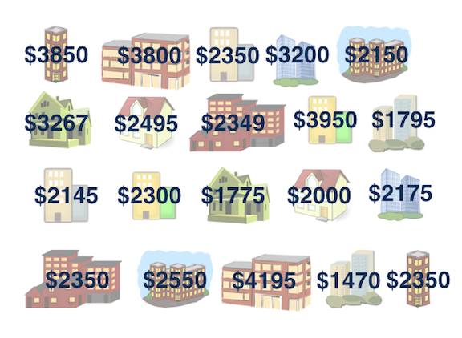
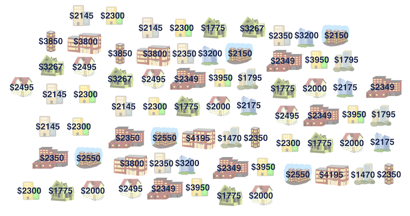
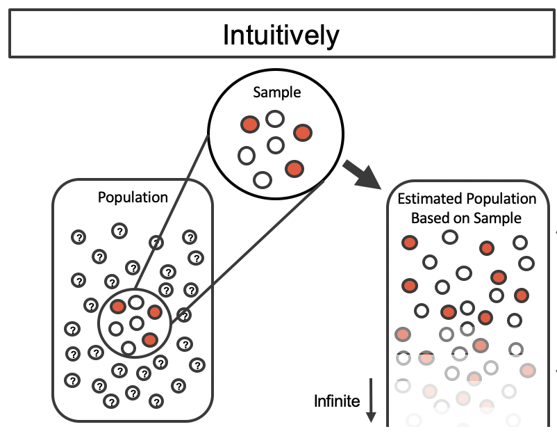
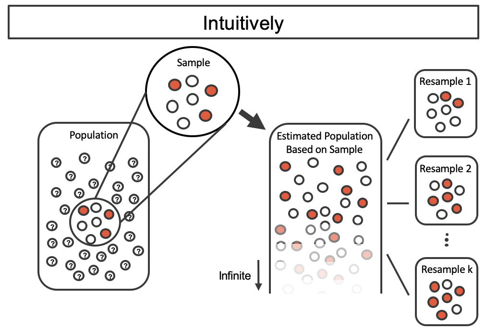
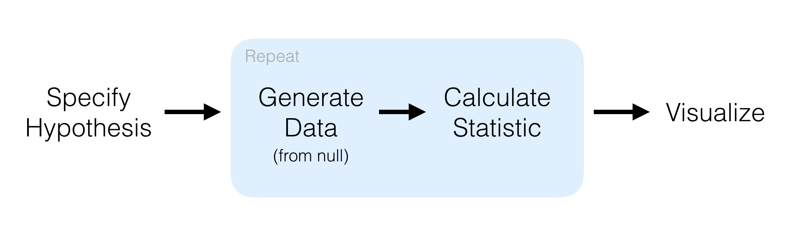

#  {visibility="hidden"}

\def\bx{\mathbf{x}}
\def\bg{\mathbf{g}}
\def\bw{\mathbf{w}}
\def\balpha{\boldsymbol \alpha}
\def\bbeta{\boldsymbol \beta}
\def\beps{\boldsymbol \epsilon}
\def\bLambda{\boldsymbol \Lambda}
\def\bX{\mathbf{X}}
\def\by{\mathbf{y}}
\def\bH{\mathbf{H}}
\def\bI{\mathbf{I}}
\def\bS{\mathbf{S}}
\def\bW{\mathbf{W}}
\def\T{\text{T}}
\def\cov{\mathrm{Cov}}
\def\cor{\mathrm{Corr}}
\def\var{\mathrm{Var}}
\def\E{\mathrm{E}}
\def\bmu{\boldsymbol \mu}
\DeclareMathOperator*{\argmin}{arg\,min}
\def\Trace{\text{Trace}}

```{r}
#| label: setup
#| include: false
library(countdown)
library(emo)
library(knitr)
library(gt)
library(gtExtras)
library(ggplot2)
library(tidyverse)
library(tidymodels)
library(ISLR)
library(car)
library(olsrr)
library(leaps)
library(MASS)
library(kableExtra)
library(glue)
knitr::opts_chunk$set(
    fig.asp = 0.618,
    fig.align = "center",
    out.width = "100%",
    fig.retina = 10,
    fig.path = "./images/11-bootstrap/",
    message = FALSE,
    global.par = TRUE
)

options(
  htmltools.dir.version = FALSE,
  dplyr.print_min = 6, 
  dplyr.print_max = 6,
  tibble.width = 80,
  width = 80,
  digits = 3
  )


theme_set(
  theme_classic(base_size = 18) +
    theme(
      panel.grid.minor = element_blank(),
      plot.title = element_text(face = "bold"),
      plot.subtitle = element_text(size = 16),
      strip.text = element_text(face = "bold"),
      legend.position = "bottom"
    )
)

hook_output <- knitr::knit_hooks$get("output")
knitr::knit_hooks$set(output = function(x, options) {
  lines <- options$output.lines
  if (is.null(lines)) {
    return(hook_output(x, options))  # pass to default hook
  }
  x <- unlist(strsplit(x, "\n"))
  more <- "..."
  if (length(lines)==1) {        # first n lines
    if (length(x) > lines) {
      # truncate the output, but add ....
      x <- c(head(x, lines), more)
    }
  } else {
    x <- c(more, x[lines], more)
  }
  # paste these lines together
  x <- paste(c(x, ""), collapse = "\n")
  hook_output(x, options)
})
# ggplot2::theme_set(ggplot2::theme_bw(base_size = 16))
```

# Bootstrapping

<h2> Idea of Bootstrapping </h2>
<h2> Bootstrap Confidence Interval </h2>
<h2> Bootstrap Confidence Interval for Linear Regression </h2>
<!-- <h2> Randomization test for Linear Regression* </h2> -->

::: notes
- When CLT can no longer use applied, bootstraping is a way to quantify uncertainty. 
- It doesn't mean that we cannot use bootstraping when CLT is applicable. OK. 
- You can probably do bootstraping using your sample under any situation. 
- In other words, the method can be widely used in many situations, and in fact it is very popular in statistics and machine learning.
- Ok let's see what it is.
:::

## Why Simulation-based Inference?

- Let's go back to MATH 4720. How do we do interval estimation for population mean $\mu$?

. . .

- $z$-interval when $\sigma$ is known
- Student's $t$-interval when $\sigma$ is unknown

::: question
What are the assumptions in order to use $z$ or $t$ intervals?
:::

. . .

::: alert

The population is Gaussian. If not, the sample size is large enough so that the central limit theorem can be applied!

:::


. . .

::: danger
We never answer this question in MATH 4720. What if the population is **not** Gaussian and the sample size $n$ is **small**, i.e., **CLT becomes powerless?**
:::


## Bootstrapping `r emo::ji('boot')`

:::: {.columns}

::: {.column width="50%"}

- The term **bootstrapping** comes from the phrase 

> *pulling oneself up by one’s bootstraps*

which is a metaphor for accomplishing an impossible task without any outside help.

- **Impossible task**: estimating population parameter with uncertainty using data from [*only the given single sample dataset, without CI formula and replicates of data generated from the assumed probability model*]{.green}.

:::


::: {.column width="50%"}

::: tiny

```{r}
#| out-width: 90%
#| fig-cap: "Source: http://dailywhiteboard.blogspot.com/2014/04/day-251-pull-yourself-up-by-your.html"

```

:::

:::

::::


::: notes
- **Note**: Notion of saying something about a population parameter using only information from an observed sample is the crux of statistical inference, it is not limited to bootstrapping.
- The term **bootstrapping** comes from the phrase "*pulling oneself up by one’s bootstraps*", which is a metaphor for accomplishing an impossible task without any outside help.
- In statistics scenario, it means that we are estimating a population parameter using data from *only the given single sample dataset, without CI formula and/or replicates of data*. 
- I call it **Impossible task**, but that's basically what statistics usually does.
- So notion of saying something about a population parameter using only information from an observed sample is the crux of statistical inference, it is not limited to bootstrapping.
:::


## Rent in Manhattan

::: question
How much do you think it costs to rent a typical 1 bedroom apartment in Manhattan?
:::
```{r}

```


::: notes
- Here is our example. How much do you think it costs to rent a typical 1 bedroom apartment in Manhattan NYC?
- Well if you have no idea, at least we can say we are 100% confident that the average one-bedroom rent in Manhattan is between 0 to one million dollars.
- it's not helping though.
:::

## [Data](./data/manhattan.csv)

- Consider 20 one-bedroom apartments that were randomly selected on Craigslist Manhattan from apartments listed as "by owner".


```{r}
#| echo: true
#| code-line-numbers: false
manhattan <- read.csv("./data/manhattan.csv")
range(manhattan)
t(manhattan)
```


::: notes
- The minimum is 1470 and the rent can be as high as near $4200.
:::


## Parameter of Interest

- Could focus on the median rent or mean rent depending on our research goal.

```{r}
#| out-width: 70%
#| code-line-numbers: false
ggplot(data = manhattan, mapping = aes(x = rent)) +
    geom_histogram(binwidth = 250) +
    labs(title = "Rent of 1 BR apartment in Manhattan")
```

::: notes
- We could focus on the median rent or mean rent depending on our research goal. Sometimes we are interested in other quantiles, not just median.

<!-- - .question[ -->
<!-- `r emo::ji("bust_in_silhouette")` Is the mean or the median a better measure of typical rent in Manhattan? -->
<!-- ] -->
:::


## Observed Sample vs. Bootstrap Population

**IDEA: _We assume the sample is [representative]{.red} of the population, so create an artificial population by [replicating the subjects from the observed ones]{.red}._**

:::: {.columns}

::: {.column width="50%"}
```{r}
#| out-width: 90%

```


Sample median = $`r manhattan %>% summarise(med_rent = median(rent)) %>% pull()`
:::


::: {.column width="50%"}

```{r}

```


Population median = `r emo::ji("question")`
:::
::::


::: notes
- So based on the sample, the sample median rent is $2350.
- The question is What's our BT population look like that we can sample from?
- Well the idea is that we assume that there are probably more apartments like the ones in our observed sample in the population as well.
- So here, basically the BT artificial population is made from our sample data, and the population is like so many replicates of our given sample.
- Again, this is an artificial population, not the real population. If I had the real population, no inference  or estimation is needed. We know the truth. Right.
:::

## Bootstrap Population

::: tiny

```{r}
#| out-width: 60%
#| fig-cap: "Source: Figure 12.1 of Introduction to Modern Statistics"

```

:::

## Bootstrap Sampling


::: tiny

```{r}
#| out-width: 70%
#| fig-cap: "Source: Figure 12.2 of Introduction to Modern Statistics"

```

:::


## Practical Bootstrap Sampling

::: tiny

```{r}
#| out-width: 70%
#| fig-cap: "Source: Figure 12.4 of Introduction to Modern Statistics"
knitr::include_graphics("./images/11-bootstrap/boot1prop4.png")
```

:::


::: notes
Taking repeated resamples from the sample data is the same process as creating an
infinitely large estimate of the population. It is computationally more feasible to take resamples
directly from the sample. Note that the resampling is now done with replacement (that is, the original
sample does not ever change) so that the original sample and estimated hypothetical population are
equivalent.
::: 


## Bootstrapping Algorithm

::: instructions
- **[1] Take a bootstrap sample** 
  + [a random sample taken **with replacement** from the original sample, of the **same size** as the original sample.]{.blue}
  
- **[2] Calculate the bootstrap statistic** 
  + [a statistic such as mean, median, proportion, slope, etc. computed on the bootstrap samples.]{.blue}
  
- **[3] Repeat steps (1) and (2) many times to create a bootstrap distribution**
  + [a distribution of bootstrap statistics.]{.blue}
  
- **[4] Calculate the bounds of the $(1-\alpha)100\%$ confidence interval**
  + [the middle $(1-\alpha)100\%$ of the bootstrap distribution.]{.blue}
  
:::


::: notes
- So the BT scheme or algorithm is like this.
- **[1] Take a bootstrap sample** - a random sample taken **with replacement** from the 
original sample, of the **same size** as the original sample. In this case it'll be 20.
- **[2] Calculate the bootstrap statistic** - a statistic such as mean, median, 
proportion, slope, etc. computed on the bootstrap samples. Here we compute the median.
- **[3] Repeat steps (1) and (2) many times to create a bootstrap distribution** - 
a distribution of bootstrap statistics.
- Finally we can make a histogram of those BT statistics, and **[4] Calculate the bounds of the $(1-\alpha)100\%$ confidence interval** as the middle $(1-\alpha)100\%$ of the bootstrap distribution.
:::


## The infer `r emo::ji("package")` in [tidymodels](https://www.tidymodels.org/) {visibility="hidden"} {visibility="hidden"}


:::: {.columns}

::: {.column width="80%"}
- The objective of this package is to perform statistical inference using an expressive statistical grammar that coheres with the `tidyverse` framework.

- <https://infer.netlify.app/>
:::


::: {.column width="20%"}
```{r}
#| out-width: 100%
knitr::include_graphics("https://raw.githubusercontent.com/rstudio/hex-stickers/main/SVG/infer.svg")
```
:::
::::

. . .

```{r}

```


::: notes
- So now we get the idea of BT. Let's see how to do it in R.
- You can write your own code to implement the BT.
- But here, we use the infer package to do so. It is one of the tidymodels package.
- The infer package performs statistical inference using an expressive statistical grammar that coheres with the `tidyverse` design framework.
- So in R we have `tidyverse` for data wrangling and visualization, and we have tidymodels for inference and modeling.
- The tidymodels framework is pretty young. It's website was released last year. It is not very mature at this time, but I believe it will get more and more functionality and will be getting popular because its syntax is similar to tidyverse syntax.
- The idea of using the infer package is basically shown in this workflow.
- We start with specifying a hypothesis or response and predictors in general. In our case, we just specify the response variable of interest. Here our variable of interest is the rent.
- And once the variable of interest is specified, we can start generating data and calculating the sample statistic we want. So in our case, we generate our data using BT, and we calculate the median. 
- And finally we can visualise the BT distribution and do the inference.
:::

## Generate Bootstrap Samples of Medians from [infer `r emo::ji("package")`](https://infer.netlify.app/) {visibility="hidden"}

+ `specify()` the variable of interest.

```{r}
#| echo: true
#| eval: false
#| code-line-numbers: false
manhattan |>
    # specify the variable of interest
    specify(response = rent) #<<
```


::: notes
- All right, let's do it step by step.
- First we specify our response variable using specify(response = rent)
:::


## Generate Bootstrap Samples of Medians {visibility="hidden"}

+ `specify()` the variable of interest.
+ `generate()` a fixed number of bootstrap samples.

```{r}
#| echo: true
#| eval: false
#| code-line-numbers: false
manhattan |> 
    # specify the variable of interest
    specify(response = rent) |>
    # generate 15000 bootstrap samples
    generate(reps = 15000, type = "bootstrap")  #<<
```

::: notes
- And then we generate our BT samples using generate() function, reps 15000 times, and specify type = "bootstrap".
:::


## Generate Bootstrap Samples of Medians {visibility="hidden"}
+ `specify()` the variable of interest.
+ `generate()` a fixed number of bootstrap samples.
+ `calculate()` the bootstrapped statistic(s).

```{r}
#| echo: true
#| eval: false
#| code-line-numbers: false
manhattan |> 
    # specify the variable of interest
    specify(response = rent) |>
    # generate 15000 bootstrap samples
    generate(reps = 15000, type = "bootstrap") |>
    # calculate the median of each bootstrap sample
    calculate(stat = "median")  #<<
```


::: notes
- Once we collect or BT samples, we calculate the bootstrapped statistic(s) which is median using calculate() function. 
- The stat argument is "median"

:::


## Generate Bootstrap Samples of Medians using [`infer` `r emo::ji("package")`](https://infer.netlify.app/)

+ `specify()` the variable of interest.
+ `generate()` a fixed number of bootstrap samples.
+ `calculate()` the bootstrapped statistic(s).
+ save bootstrapping distribution for analysis.

```{r}
#| echo: true
#| eval: true
#| code-line-numbers: false

library(tidymodels)
# save resulting bootstrap distribution
boot_sample <- manhattan |> 
    # specify the variable of interest
    specify(response = rent) |>  
    # generate 15000 bootstrap samples
    generate(reps = 15000, type = "bootstrap") |>  
    # calculate the median of each bootstrap sample
    calculate(stat = "median")
```

::: notes
- Then we are done! We have the BT samples or distribution of median rent for analysis.
- I just save it to the object called boot_sample.
:::


## The bootstrap Sample

::: question
`r emo::ji("bust_in_silhouette")` How many observations are there in `boot_sample`? What does each observation represent?
:::

```{r}
#| echo: true
#| code-line-numbers: false
dplyr::glimpse(boot_sample)
```

- Each replicate median rent is calculated from a bootstrapped sample of size 20 from our original sample data.

::: notes
- So now you can see that we have 15000 median rents 
- Each replicate median rent is calculated from a bootstrapped sample of size 20 from our original sample data.
:::


## Visualize the Bootstrap Distribution

```{r}
#| echo: true
#| out-width: 65%
#| code-fold: true
#| code-line-numbers: false
bt_dist <- ggplot(data = boot_sample, mapping = aes(x = stat)) +
    geom_histogram(binwidth = 50) +
    labs(title = "Bootstrap distribution of medians")
bt_dist
```

::: notes
- And this is the bootstrap distribution of medians that is generated purely by our sample data, and it is generated without using normal assumptions or CLT.
:::


## Calculate the CI

:::: {.columns}

::: {.column width="40%"}
```{r}
#| echo: true
#| code-line-numbers: false
bt_ci <- infer::get_ci(
  boot_sample, level = .95)
bt_ci
```
:::


::: {.column width="60%"}
```{r}
#| label: boot-ci
#| out-width: 100%
#| echo: true
#| code-fold: true
#| code-line-numbers: false
bt_dist + geom_vline(xintercept = c(bt_ci$lower_ci, bt_ci$upper_ci), 
                     color = "blue") +
    labs(subtitle = "and 95% CI")
```
:::
::::


::: notes
A 95% confidence interval is bounded by the middle 95% of the bootstrap distribution.
:::


# Bootstrapped CI for the Regression Slope

## Quantify the Variability of the Slope

In simple linear regression, we

- Bootstrap new samples $\{x^b_j, y^b_j\}_{j=1}^n$ from the original sample $\{x_i, y_i\}_{i=1}^n$.

- Fit models to each of the bootstrapped samples and estimate the slope.

- Use the distribution of the bootstrapped slopes to construct a confidence interval.


```{r}
set.seed(2026)
# Load the data set
delivery <- read.csv(file = "./data/data-ex-3-1.csv",
                     header = TRUE)
delivery_data <- delivery[, -1]
colnames(delivery_data) <- c("time", "cases", "distance")
df_boot_samples_5 <- delivery_data |> 
  specify(time ~ cases) |> 
  generate(reps = 5, type = "bootstrap")
```


## Bootstrap Sample 1

::: columns
::: {.column width="50%"}
```{r}
#| out-width: 100%

p_df_obs <- ggplot(delivery_data, aes(x = cases, y = time)) +
  geom_point(size = 3) +
  geom_smooth(method = "lm", se = FALSE, color = "red") +
  labs(
    x = "Number of Cases",
    y = "Delivert Time (min)",
    title = "Delivery Time vs. Number of Cases of Producted Stocked"
  ) +
  scale_x_continuous(labels = label_number())

p_df_obs
```
:::

::: {.column width="50%"}
```{r}
#| out-width: 100%

replicate_no <- 1

ggplot(df_boot_samples_5 |> filter(replicate == replicate_no), 
       aes(x = cases, y = time)) +
  geom_point(alpha = 0.5, size = 3) +
  geom_line(stat = "smooth", method = "lm", se = FALSE, alpha = 0.8) +
  labs(
    x = "Number of Cases",
    y = "Delivert Time (min)",
    title = glue("Bootstrap sample {replicate_no}")
  ) +
  scale_x_continuous(labels = label_number())
```
:::
:::

## Bootstrap Sample 2

::: columns
::: {.column width="50%"}
```{r}
#| out-width: 100%
p_df_obs
```
:::

::: {.column width="50%"}
```{r}
#| out-width: 100%

replicate_no = 2

ggplot(df_boot_samples_5 |> filter(replicate == replicate_no), 
       aes(x = cases, y = time)) +
  geom_point(alpha = 0.5, size = 3) +
  geom_line(stat = "smooth", method = "lm", se = FALSE, alpha = 0.8) +
  labs(
    x = "Number of Cases",
    y = "Delivert Time (min)",
    title = glue("Bootstrap sample {replicate_no}")
  ) +
  scale_x_continuous(labels = label_number())
```
:::
:::

## Bootstrap Sample 3

::: columns
::: {.column width="50%"}
```{r}
#| out.width: "100%"

p_df_obs
```
:::

::: {.column width="50%"}
```{r}
#| out-width: 100%

replicate_no = 3

ggplot(df_boot_samples_5 |> filter(replicate == replicate_no), 
       aes(x = cases, y = time)) +
  geom_point(alpha = 0.5, size = 3) +
  geom_line(stat = "smooth", method = "lm", se = FALSE, alpha = 0.8) +
  labs(
    x = "Number of Cases",
    y = "Delivert Time (min)",
    title = glue("Bootstrap sample {replicate_no}")
  ) +
  scale_x_continuous(labels = label_number())
```
:::
:::

## Bootstrap Sample 4

::: columns
::: {.column width="50%"}
```{r}
#| out-width: 100%

p_df_obs
```
:::

::: {.column width="50%"}
```{r}
#| out-width: 100%

replicate_no = 4

ggplot(df_boot_samples_5 |> filter(replicate == replicate_no), 
       aes(x = cases, y = time)) +
  geom_point(alpha = 0.5, size = 3) +
  geom_line(stat = "smooth", method = "lm", se = FALSE, alpha = 0.8) +
  labs(
    x = "Number of Cases",
    y = "Delivert Time (min)",
    title = glue("Bootstrap sample {replicate_no}")
  ) +
  scale_x_continuous(labels = label_number())
```
:::
:::

## Bootstrap Sample 5

::: columns
::: {.column width="50%"}
```{r}
#| out-width: 100%

p_df_obs
```
:::

::: {.column width="50%"}
```{r}
#| out-width: 100%

replicate_no = 5

ggplot(df_boot_samples_5 |> filter(replicate == replicate_no), 
       aes(x = cases, y = time)) +
  geom_point(alpha = 0.5, size = 3) +
  geom_line(stat = "smooth", method = "lm", se = FALSE, alpha = 0.8) +
  labs(
    x = "Number of Cases",
    y = "Delivert Time (min)",
    title = glue("Bootstrap sample {replicate_no}")
  ) +
  scale_x_continuous(labels = label_number())
```
:::
:::

. . .

*so on and so forth...*

## Bootstrap Samples 1 - 5

::: columns
::: {.column width="50%"}
```{r}
#| out-width: 100%

p_df_obs
```
:::

::: {.column width="50%"}
```{r}
#| out-width: 100%

ggplot(df_boot_samples_5, aes(x = cases, y = time, group = replicate)) +
  geom_line(stat = "smooth", method = "lm", se = FALSE, alpha = 0.5) +
  labs(
    x = "Number of Cases",
    y = "Delivert Time (min)",
    title = glue("Bootstrap samples 1 - 5")
  ) +
  scale_x_continuous(labels = label_number())
```
:::
:::

## Bootstrap Samples 1 - 100

```{r}
set.seed(2026)

df_boot_samples_100 <- delivery_data |> 
  specify(time ~ cases) |> 
  generate(reps = 100, type = "bootstrap")
```

::: columns
::: {.column width="50%"}
```{r}
#| out-width: 100%

p_df_obs
```
:::

::: {.column width="50%"}
```{r}
#| out.width: 100%

p_df_boot_samples_100 <- ggplot(df_boot_samples_100, aes(x = cases, y = time, group = replicate)) +
  geom_line(stat = "smooth", method = "lm", se = FALSE, alpha = 0.05) +
  labs(
    x = "Number of Cases",
    y = "Delivert Time (min)",
    title = glue("Bootstrap samples 1 - 100")
  ) +
  scale_x_continuous(labels = label_number())

p_df_boot_samples_100
```
:::
:::

## Slopes of bootstrap samples {visibility="hidden"}

:::: {.columns}

::: {.column width="50%"}

```{r}
df_fit <- linear_reg() %>%
  set_engine("lm") %>%
  fit(time ~ cases, data = delivery_data)
intercept <- df_fit$fit$coefficients[1]
slope <- df_fit$fit$coefficients[2]
p_df_boot_samples_100 +
  geom_abline(intercept = intercept, slope = slope, color = "red", 
              linewidth = 2)
```
:::


::: {.column width="50%"}


```{r}
df_boot_samples_100_fit <- df_boot_samples_100 |> 
  fit()

df_boot_samples_100_hist <- ggplot(df_boot_samples_100_fit %>% filter(term == "cases"), aes(x = estimate)) +
  geom_histogram(binwidth = 0.05, color = "white") +
  geom_vline(xintercept = slope, color = "red", linewidth = 2) +
  labs(x = "Slope", y = "Count",
       title = "Slopes of 100 bootstrap samples")

df_boot_samples_100_hist
```
:::
::::


## Slopes of Bootstrap Samples and Bootstrapped CI

:::: {.columns}

::: {.column width="50%"}

```{r}
p_df_boot_samples_100 +
  geom_abline(intercept = intercept, slope = slope, color = "red", linewidth = 2)
```
:::


::: {.column width="50%"}


```{r}
lower <- df_boot_samples_100_fit %>%
  ungroup() %>%
  filter(term == "cases") %>%
  summarise(quantile(estimate, 0.025)) %>%
  pull()

upper <- df_boot_samples_100_fit %>%
  ungroup() %>%
  filter(term == "cases") %>%
  summarise(quantile(estimate, 0.975)) %>%
  pull()

df_boot_samples_100_hist +
    geom_vline(xintercept = lower, color = "#66CDAA", linewidth = 2, linetype = "dashed") +
  geom_vline(xintercept = upper, color = "#66CDAA", linewidth = 2, linetype = "dashed")
```

:::

::::

- A 95% confidence interval is bounded by the middle 95% of the bootstrap distribution.


## Fit Regression to Bootstrap Samples using [`infer` `r emo::ji("package")`](https://infer.netlify.app/)

<!-- Take `100` bootstrap samples and fit models to each one: -->

:::: {.columns}

::: {.column width="55%"}

```{r}
#| echo: true
#| eval: false
#| code-line-numbers: false
set.seed(2026)
boot_fits <- delivery_data |> 
  specify(time ~ cases) |> 
  generate(reps = 100, type = "bootstrap") |> 
  fit()
boot_fits
```

:::


::: {.column width="45%"}

```{r}
#| echo: false
#| eval: true
#| class-output: my_classfull
#| code-line-numbers: false
set.seed(2026)
boot_fits <- delivery_data |> 
  specify(time ~ cases) |> 
  generate(reps = 100, type = "bootstrap") |> 
  fit()
print(boot_fits, n = 20)
```

:::

::::

## Bootstrap CI Methods

- **Percentile method**: Compute the 95% CI as the middle 95% of the bootstrap distribution:

```{r}
#| echo: true
#| code-line-numbers: false
observed_fit <- delivery_data |> 
  specify(time ~ cases) |> 
  fit()
boot_fits |> get_ci(point_estimate = observed_fit, type = "percentile")
```

. . .

- **Standard error method**: Compute the 95% CI as the point estimate $\pm$ \~2 standard deviations of the bootstrap distribution:

```{r}
#| echo: true
#| code-line-numbers: false
boot_fits |> get_ci(point_estimate = observed_fit, type = "se")
```


::: notes
confint(lm(time~cases, data = delivery_data))
:::

## `car::Boot()` {visibility="hidden"}

- `car::Boot()` is a simple interface to the `boot::boot()`.

```{r}
#| echo: true
lm_fit <- lm(time ~ cases, data = delivery_data)
car_boot <- car::Boot(lm_fit, R = 100)
car::brief(car_boot$t)
```

## Histogram of Bootstrap Samples {visibility="hidden"}

- BC$_a$ is the **accelerated bias-corrected percentile interval**.

```{r}
#| echo: true
#| out-width: 80%
hist(car_boot)
```


## `car::Confint()` {visibility="hidden"}

```{r}
#| echo: true
car::Confint(lm_fit, vcov. = vcov(car_boot))
```


::: notes

check boot::boot.ci

:::


## `boot::boot()` {visibility="hidden"}

- <https://stats.oarc.ucla.edu/r/faq/how-can-i-generate-bootstrap-statistics-in-r/> 

- ISL Lab 5.3.4