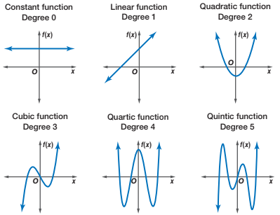
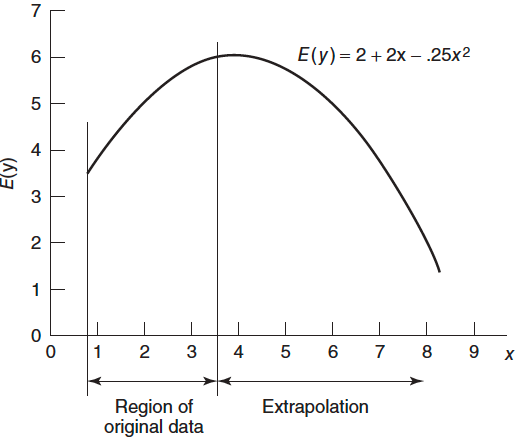

#  {visibility="hidden"}

\def\bx{\mathbf{x}}
\def\bg{\mathbf{g}}
\def\bw{\mathbf{w}}
\def\balpha{\boldsymbol \alpha}
\def\bbeta{\boldsymbol \beta}
\def\beps{\boldsymbol \epsilon}
\def\bX{\mathbf{X}}
\def\by{\mathbf{y}}
\def\bH{\mathbf{H}}
\def\bI{\mathbf{I}}
\def\bS{\mathbf{S}}
\def\bW{\mathbf{W}}
\def\T{\text{T}}
\def\cov{\mathrm{Cov}}
\def\cor{\mathrm{Corr}}
\def\var{\mathrm{Var}}
\def\E{\mathrm{E}}
\def\bmu{\boldsymbol \mu}
\DeclareMathOperator*{\argmin}{arg\,min}
\def\Trace{\text{Trace}}


```{r}
#| label: setup
#| include: false
#| eval: true
library(countdown)
library(emo)
library(knitr)
library(gt)
library(gtExtras)
library(ggplot2)
library(tidyverse)
library(tidymodels)
library(MASS)
library(car)
knitr::opts_chunk$set(
    fig.asp = 0.6,
    fig.align = "center",
    out.width = "70%",
    fig.retina = 10,
    fig.path = "./images/11-poly-reg/",
    message = FALSE,
    global.par = TRUE
)
options(
  htmltools.dir.version = FALSE,
  dplyr.print_min = 6, 
  dplyr.print_max = 6,
  tibble.width = 80,
  width = 80,
  digits = 3
  )
hook_output <- knitr::knit_hooks$get("output")
knitr::knit_hooks$set(output = function(x, options) {
  lines <- options$output.lines
  if (is.null(lines)) {
    return(hook_output(x, options))  # pass to default hook
  }
  x <- unlist(strsplit(x, "\n"))
  more <- "..."
  if (length(lines)==1) {        # first n lines
    if (length(x) > lines) {
      # truncate the output, but add ....
      x <- c(head(x, lines), more)
    }
  } else {
    x <- c(more, x[lines], more)
  }
  # paste these lines together
  x <- paste(c(x, ""), collapse = "\n")
  hook_output(x, options)
})
par(cex = 4)
```


<!-- ```{r} -->
<!-- #| echo: false -->
<!-- CIA <- read.table("./data/CIA.txt", header = TRUE) -->
<!-- ciafit <- lm(infant ~ gdp + health + gini, data = CIA) -->
<!-- r_stud <- rstudent(ciafit) -->
<!-- logciafit <- lm(log(infant) ~ gdp + health + gini, data = CIA) -->
<!-- ``` -->


# Polynomial Regression
<h2> Polynomial Models in One Variable </h2>
<h2> Piecewise Regression </h2>
<h2> Splines </h2>


## Why Polynomial Regression

- Polynomials are widely used in situations where the response surface is curvilinear.
- Many complex nonlinear relationships can be adequately modeled by polynomials over reasonably small ranges of the $x$'s.

```{r}
par(mfrow = c(1, 2))
par(mar = c(2, 2, 2, 0), mgp = c(0.5, 0, 0), las = 1)
x <- seq(-1, 1, by = 0.01)
y_qua <- 1 + x - 3 * x ^ 2 + rnorm(length(x), 0, 1)
y_cube <- 1 + x - x ^ 2 + 5 * x ^ 3 + rnorm(length(x), 0, 1)
plot(x, y_qua, xlab = "x", ylab = "y", 
     main = expression(paste("E(y | x) = 1 + x - 3", x^2)),cex.main = 2,
     pch = 16, col = 4, xaxt = "n",  yaxt = "n", cex = 0.8)
lines(x, 1 + x - 3 * x ^ 2, col = 2, lwd = 3)
plot(x, y_cube, xlab = "x", ylab = "y", cex.main = 2,
     main = expression(paste("E(y | x) = 1 + x - ", x^2, " + 5", x^3)),
     pch = 16, col = 4, xaxt = "n",  yaxt = "n", cex = 0.8)
lines(x, 1 + x - x ^ 2 + 5 * x ^ 3, col = 2, lwd = 3)
```

::: notes
- They are also useful as approximating functions to unknown and possibly very complex nonlinear relationships.
- In this sense, the polynomial model is just the Taylor series expansion of the unknown function.
:::


## Polynomial Regression Models

- A **second**-order (degree) polynomial in **one** variable describing **quadratic** pattern is
$$y = \beta_0 + \beta_1 x + \beta_2 x^2 + \epsilon$$

- A **second**-order polynomial in **two** variables is
$$y = \beta_0 + \beta_1 x_1 + \beta_2 x_2 + \beta_{11}x_1^2 + \beta_{22}x_2^2 + \beta_{12}x_1x_2 + \epsilon$$

- The **$k$th-order** polynomial model in **one** variable is
$$y = \beta_0 + \beta_1 x + \beta_2 x^2 + \cdots + \beta_kx^k + \epsilon$$

- If we set $x_j = x^j$, this is just a multiple linear regression model with $k$ predictors $x_1, x_2, \dots, x_k$!


## Important Considerations

::: large
_Keep the order of the model **as low as possible**_.
:::

:::: {.columns}

::: {.column width="50%"}
- Transform data to keep the model 1st order.

- If fails, try a 2nd order model.

- Avoid high-order polynomials unless supported by scientific reasoning or demonstrated predictive benefit.

- `r emo::ji('point_right')` **Occam's Razor**: among competing models that predict equally well, choose the "simplest" one, i.e., a **parsimonious** model.
  + This avoids **overfitting** that leads to nearly perfect fit to the data, but bad prediction performance.
  
:::

::: {.column width="50%"}

::: tiny
```{r}
#| fig-cap: "Source: Wikiversity"

```
:::
:::


::::
  
::: notes
There are several important considerations that arise when fitting a polynomial
in one variable.
- A low-order model in a transformed variable is usually always preferable to a high-order model in the original metric. 
- Arbitrary fitting of high-order polynomials is a serious abuse of regression analysis.
- You can always fit a polynomial model with very high order. It may give you a pretty good fit, but with very high chance, it will end up with very bad prediction, leading to overfitting.
  + **Occam's Razor**: among competing models that predict equally well, choose the "simplest" one, i.e., **parsimonious** model.
  + This avoid **overfitting** that leads to bad prediction performance.

:::

. . .

::: alert
*"Bayesian Deep Learning and a Probabilistic Perspective of Generalization"* Wilson and Izmailov (2020) for the rationale of choosing a super high-order polynomial as the regression model.
:::

::: notes
- the ground truth explanation for the data is out of class for any of these choices, but there is some setting of the coefficients in choice (3) which provides a better description of reality than could be managed by choices (1)
and (2).
- our beliefs about the generative processes for our observations, which are often very sophisticated, typically ought to be independent of how many data points we happen to observe.
- we often use neural networks with millions of parameters to fit datasets with thousands of points
- For ordinary least-squares polynomial regression, use the lowest degree that adequately captures the systematic relationship. Do not increase the degree merely to improve the training fit.
- Later, in Bayesian statistics and machine learning, you will see that highly parameterized models can still generalize well when their effective complexity is controlled by priors, regularization, or model structure.
:::


## Important Considerations

::: large
*Model building strategy*
:::

- `r emo::ji('point_right')` **Forward selection**: successively fit models of increasing order until the $t$-test for the highest order term is non-significant.

- `r emo::ji('point_right')` **Backward elimination**: fit the highest order model and then delete terms one at a time until the highest order remaining term has a significant $t$ statistic.

- `r emo::ji('point_right')` They do not necessarily lead to the same model.

- `r emo::ji('point_right')` Restrict our attention to low-order polynomials.


::: alert
**HIERARCHY PRINCIPLE**: $X^K$ included $\implies$ $x$, $x^2, \dots, x^{k-1}$ included.
:::


::: notes

- Because the tests depend on what other terms are in the model, forward and backward procedures can give different answers.

- If a higher-order term is included, keep its lower-order components because otherwise the model can depend on arbitrary choices such as where we define \(x=0\).

:::


## Important Considerations

::: large
*Extrapolation*
:::

- Can be extremely dangerous when the model is higher-order polynomial. 
- The nature of the true underlying relationship may change or be completely different from the system that produced the data used to fit the model.

<!-- # ```{r} -->
<!-- # #| out-width: 40% -->
<!-- #  -->
<!-- # ``` -->

```{r}
#| out-width: 100%
# Allow room below the x-axis for annotations
par(
  mar = c(0, 3, 0, 0),
  xpd = NA,
  family = "sans"
)

# Empty plotting region
plot(
  NA,
  xlim = c(0, 9.7),
  ylim = c(-1.75, 7),
  axes = FALSE,
  xlab = "",
  ylab = "",
  bty = "n"
)

# ------------------------------------------------------------
# Quadratic mean function
# E(y) = 2 + 2x - 0.25x^2
# ------------------------------------------------------------

x_curve <- seq(0.8, 8.3, length.out = 500)

Ey <- 2 + 2 * x_curve - 0.25 * x_curve^2

lines(
  x_curve,
  Ey,
  lwd = 3.2,
  col = "#2b2929"
)

# ------------------------------------------------------------
# Axes
# ------------------------------------------------------------

# Main axes
segments(0, 0, 9.7, 0, lwd = 1)
segments(0, 0, 0, 7, lwd = 1)

# X-axis ticks and labels
x_ticks <- 0:9

segments(
  x0 = x_ticks,
  y0 = 0,
  x1 = x_ticks,
  y1 = 0.27,
  lwd = 1.9
)

text(
  x_ticks,
  y = -0.18,
  labels = x_ticks,
  adj = c(0.5, 1),
  cex = 1.5
)

# Y-axis ticks and labels
y_ticks <- 0:7

segments(
  x0 = 0,
  y0 = y_ticks,
  x1 = 0.28,
  y1 = y_ticks,
  lwd = 1.9
)

text(
  x = -0.18,
  y = y_ticks,
  labels = y_ticks,
  adj = c(1, 0.5),
  cex = 1.5
)

# Axis labels
text(
  x = 9.72,
  y = -0.18,
  labels = expression(x),
  adj = c(0, 0.5),
  cex = 1.5
)

text(
  x = -0.82,
  y = 3.5,
  labels = expression(E(y ~ "|" ~ x)),
  srt = 90,
  cex = 1.5
)

# ------------------------------------------------------------
# Original-data and extrapolation boundaries
# ------------------------------------------------------------

x_original_left  <- 0.8
x_original_right <- 3.55
x_extrap_right   <- 8.0

# Vertical guide lines
segments(
  x_original_left, -1.32,
  x_original_left, 4.65,
  lwd = 1.8
)

segments(
  x_original_right, -1.32,
  x_original_right, 6.30,
  lwd = 1.8
)

# ------------------------------------------------------------
# Double-headed arrows below the x-axis
# ------------------------------------------------------------

arrow_y <- -0.98

# Region of original data
arrows(
  x0 = x_original_left,
  y0 = arrow_y,
  x1 = x_original_right,
  y1 = arrow_y,
  code = 3,
  angle = 22,
  length = 0.09,
  lwd = 2
)

# Extrapolation region
arrows(
  x0 = x_original_right,
  y0 = arrow_y,
  x1 = x_extrap_right,
  y1 = arrow_y,
  code = 3,
  angle = 22,
  length = 0.09,
  lwd = 2
)

# Region labels
text(
  x = (x_original_left + x_original_right) / 2,
  y = -1.37,
  labels = "Original data range",
  cex = 2.02,
  adj = c(0.5, 0.5)
)

text(
  x = (x_original_right + x_extrap_right) / 2,
  y = -1.37,
  labels = "Extrapolation",
  cex = 2.02,
  adj = c(0.5, 0.5)
)

# ------------------------------------------------------------
# Equation annotation
# ------------------------------------------------------------

text(
  x = 5.25,
  y = 5.95,
  labels = expression(E(y ~ "|" ~ x) == 2 + 2*x - .25*x^2),
  cex = 2.05,
  adj = c(0, 0.5)
)

# dev.off()
```

::: notes
- 因為最高次方項最後一定會 dominate。


:::


## Important Considerations

::: large
*Ill-conditioning*
:::

  + **Ill-conditioning**: *As polynomial order increases, ${\bf X'X}$ matrix inversion will become numerically unstable*, and error may be introduced into the parameter estimates
  + Centering the predictors may remove some ill conditioning but not all.
  + One solution is to use **orthogonal polynomials** (LRA Sec 7.5).
  
  
::: notes
  + **Ill-conditioning** refers to the fact that *as the order of the model increases, ${\bf X'X}$ matrix inversion will become inaccurate*, and error can be introduced into the parameter estimates
  + Centering the predictors may remove some ill conditioning but not all.
:::

## [Hardwood Data](./data/data-ex-7-1.csv) (LRA Example 7.1)
- Strength of kraft paper vs. the percentage of hardwood in the batch of pulp from which the paper was produced.
- A quadratic model may adequately describe the relationship between tensile strength and hardwood concentration.

:::: {.columns}

::: {.column width="33%"}
```{r}
#| echo: !expr c(3)
#| code-line-numbers: false
#| class-output: my_class500
hardwood <- read.csv(file = "./data/data-ex-7-1.csv", header = TRUE)
colnames(hardwood) <- c("conc", "strength")
hardwood[1:9, ]
```
:::

::: {.column width="66%"}
```{r}
#| out-width: 90%
par(mar = c(3.5, 3.5, 0, 0), mgp = c(2, 0.8, 0), las = 1)
par(mfrow = c(1, 1))
plot(hardwood$conc, hardwood$strength, pch = 16, 
     xlab = "Hardwood concentration %", ylab = "Tensile strength",
     xlim = c(0, 16), ylim = c(0, 60), cex.lab = 1.5, cex = 2)
```
:::
::::


## Hardwood Data Model Fitting

- Following the suggestion that centering the data may remove nonessential ill-conditioning:
$$y = \beta_0 + \beta_1 (x - \bar{x}) + \beta_2 (x - \bar{x}) ^ 2 + \epsilon$$

```{r}
#| echo: true
#| code-line-numbers: false
conc_cen <- hardwood$conc - mean(hardwood$conc)
lm(strength ~ conc_cen + I(conc_cen ^ 2), data = hardwood)
```

- $\hat{y}= 45.3 + 2.55 (x - 7.26) - 0.63 (x - 7.26) ^ 2$
- Inference, prediction and residual diagnostics procedures are the same as multiple linear regression.


::: notes
- We don't need to create an extra predictor concentration ^ 2 in the data set.
- We can construct the x_sq term in the lm() function. 
- We use I() function to wrap up the operation concen_cen ^ 2, so that concen_cen ^ 2 is not interpreted as a part of formula, but actual arithmetic operation.
- To avoid this confusion, the function I() can be used to bracket those portions of a model formula where the operators are used in their arithmetic sense. For example, in the formula y ~ a + I(b+c), the term b+c is to be interpreted as the sum of b and c.
:::


## Piecewise (Polynomial) Regression
- A polynomial regression may provide a poor fit, and increasing the order does not improve the situation.
- This may happen when *the regression function behaves differently in different parts of the range of $x$*.

. . .

- SOLUTION: `r emo::ji('point_right')` *piecewise* polynomial regression that **fits separate polynomials over different regions of $x$**.
- Example:
$$y=\begin{cases}
    \beta_{01} + \beta_{11}x+ \beta_{21}x^2+\beta_{31}x^3 +\epsilon     & \quad \text{if } x < c\\
    \beta_{02} + \beta_{12}x+ \beta_{22}x^2+\beta_{32}x^3+\epsilon      & \quad \text{if } x \ge c
  \end{cases}$$
  
- The joint points of pieces are called **knots**.

. . .

- Using more knots leads to a more flexible piecewise polynomial. 

::: question
With $K$ different knots, how many different polynomials do we have?
:::

<!-- - With $K$ different knots, we fit $K + 1$ different polynomials. -->
<!-- - Piecewise polynomials of order $k$ are called **splines**. -->

::: notes
- There might be tow different systems or schemes that govern the relationship between response and predictor variables.
- Any issue of fitting a piecewise polynomial regression?
- In other words, we fit two different polynomial functions to the data, one on the subset of the observations with $xi < c$, and one on the subset of
the observations with $xi ≥ c$. The first polynomial function has coefficients β01, β11, β21, β31, and the second has coefficients β02, β12, β22, β32. 
- Each of these polynomial functions can be fit using least squares applied to simple functions of the original predictor.
- the function is discontinuous
- locations of the knots are known, otherwise it is a nonlinear regression problem.
- WE could fit piecewise regression with order 1.
- (or more constrained?) 
:::


## [U.S. Birth Rate from 1917 to 2003](./data/birthrates.Rda)
:::: {.columns}

::: {.column width="30%"}
```{r}
#| class-output: my_class800
load("./data/birthrates.Rda")
head(birthrates, n = 20)
```
:::

::: {.column width="70%"}
```{r}
#| out-width: 100%
par(mar = c(3, 3.5, 0, 0), mgp = c(2, 0.8, 0))
plot(birthrates, pch = 19, col = 4, cex.lab = 1.5, cex = 1.5)
```
:::
::::


## A Polynomial Regression Provide a Poor Fit
```{r}
#| echo: true
#| results: hide
#| code-line-numbers: false
lmfit3 <- lm(Birthrate ~ poly(Year - mean(Year), degree = 3, raw = TRUE),  
             data = birthrates)
```


:::: {.columns}

::: {.column width="50%"}
```{r}
#| out-width: 100%
par(mar = c(3, 3.5, 2, 0), mgp = c(2, 0.8, 0))
lmfit3 <- lm(Birthrate ~ poly(Year-mean(Year), degree = 3, raw = TRUE),  data = birthrates)
plot(birthrates, pch = 19, col = 4, main = "degree = 3", cex.lab = 1.5, cex = 1.5, cex.main = 2)
lines(birthrates$Year, lmfit3$fitted.values, lty = 1, 
      col = 2, lwd = 3)
```
:::

::: {.column width="50%"}
```{r}
#| out-width: 100%
par(mar = c(3, 3.5, 2, 0), mgp = c(2, 0.8, 0))
lmfit5 <- lm(Birthrate ~ poly(Year-mean(Year), degree = 5, raw = TRUE), data = birthrates)
plot(birthrates, pch = 19, col = 4, main = "degree = 5", cex.lab = 1.5, cex = 1.5, cex.main = 2)
lines(birthrates$Year, lmfit5$fitted.values, lty = 1, 
      col = 2, lwd = 3)
```
:::
::::


::: notes
It might be interesting to fit a linear regression with high order polynomials to approximate this curve. This can be carried out using the poly() function, which calculates all polynomials up to a certain power. Please note that this is a more stable method compared with writing out the powers such as I(Year^2), I(Year^3) etc because the Year variable is very large, and is numerically unstable.
:::


## Piecewise Polynomials: 3 knots at 1936, 60, 78
```{r}
#| out-width: 65%
# par(mfrow=c(1,2))
myknots = c(1936, 1960, 1978)
bounds = c(1917, myknots, 2003)  

# # piecewise constant
# mybasis = cbind("x_1" = (birthrates$Year < myknots[1]), 
#                 "x_2" = (birthrates$Year >= myknots[1])*(birthrates$Year < mykots[2]), 
#                 "x_3" = (birthrates$Year >= myknots[2])*(birthrates$Year < mykots[3]),
#                 "x_4" = (birthrates$Year >= myknots[3]))
#     
# lmfit <- lm(birthrates$Birthrate ~ . -1, data = data.frame(mybasis))
# par(mar = c(2,3,2,0))    
# plot(birthrates, pch = 19, col = "darkorange")
# abline(v = myknots, lty = 2)
# title("Piecewise constant")
# 
# for (k in 1:4)
#     points(c(bounds[k], bounds[k+1]), rep(lmfit$coefficients[k], 2), type = "l", lty = 1, col = "deepskyblue", lwd = 4)
    
    # piecewise linear
mybasis = cbind("x_1" = (birthrates$Year < myknots[1]), 
                "x_2" = (birthrates$Year >= myknots[1])*(birthrates$Year < myknots[2]), 
                "x_3" = (birthrates$Year >= myknots[2])*(birthrates$Year < myknots[3]),
                "x_4" = (birthrates$Year >= myknots[3]),
                "x_11" = birthrates$Year*(birthrates$Year < myknots[1]), 
                "x_21" = birthrates$Year*(birthrates$Year >= myknots[1])*(birthrates$Year < myknots[2]),
                "x_31" = birthrates$Year*(birthrates$Year >= myknots[2])*(birthrates$Year < myknots[3]),
                "x_41" = birthrates$Year*(birthrates$Year >= myknots[3]))
        
lmfit <- lm(birthrates$Birthrate ~ .-1, data = data.frame(mybasis))
par(mar = c(2,3,2,0))  
plot(birthrates, pch = 19, col = 4)
abline(v = myknots, lty = 2)
title(main = list("Piecewise linear", cex = 2))

for (k in 1:4)
points(c(bounds[k], bounds[k+1]), 
       lmfit$coefficients[k] + c(bounds[k], bounds[k+1]) * lmfit$coefficients[k+4], 
       type = "l", lty = 1, col = 2, lwd = 3)
```


::: question
Any issue of piecewise polynomials?
:::


::: notes
these functions are not continuous. Hence we use a trick to construct continuous basis
:::


## Splines

<!-- Splines of degree $k$ are piecewise polynomials of degree $k$ with **continuity in derivatives** (smoothing) up to degree $k-1$ at each knot. -->

Splines of degree $k$ are piecewise polynomials of degree $k$ that are *continuous, with continuous derivatives through order $k-1$ at each knot.*


| spline degree | piecewise polynomial | continuity at knot |
|---|---|---|
| $k=1$ | linear | $f(c)$ continuous |
| $k=2$ | quadratic | $f,f'$ continuous |
| $k=3$ | cubic | $f,f',f''$ continuous |


## Linear Splines

- Use `bs()` function in the **splines** package.

```{r}
#| echo: !expr c(1)
#| out-width: 55%
#| code-line-numbers: false
lin_sp <- lm(Birthrate ~ splines::bs(Year, degree = 1, knots = c(1936, 1960, 1978)), 
             data = birthrates)
par(mar = c(3, 3, 2,0)) 
plot(birthrates, pch = 19, col = 4, main = "Linear spline (k = 1) with 3 knots",
     cex.main = 2)
lines(birthrates$Year, lin_sp$fitted.values, lty = 1, col = 2, lwd = 3)
```

::: notes
數值穩定的 B-spline basis functions
:::


## Cubic Splines

- The cubic spline is a spline of degree 3 with *first 2 derivatives are continuous* at the knots.


```{r}
#| echo: !expr c(1)
#| out-width: 55%
#| code-line-numbers: false
cub_sp <- lm(Birthrate ~ splines::bs(Year, degree = 3, knots = c(1936, 1960, 1978)), 
             data = birthrates)
par(mar = c(3, 3, 2,0)) 
plot(birthrates, pch = 19, col = 4, main = "Cubic spline (k = 3) with 3 knots",
     cex.main = 2)
lines(birthrates$Year, cub_sp$fitted.values, lty = 1, col = 2, lwd = 3)
```


## Practical Issue

- *How many knots should be used*
  + As few knots as possible
  + At least 5 data points per segment

- *Where to place the knots*
  + No more than one maximum/minimum/inflection point per segment
  + If possible, the extreme points should be centered in the segment

- *What is the degree of functions in each region*
  + Cubic spline is popular
  


## Multiple Predictors: Linear Terms with Interaction


```{r}
#| include: false
source("../scripts/plot_poly.R")
```

:::: {.columns}

$$ E(Y \mid X_1, X_2) = \beta_0 + \beta_1X_1 + \beta_2X_2 +\beta_3X_1X_2$$

::: {.column width="40%"}

- The *slices* of the surface in the direction of each predictor, holding the other constant, are *linear*.

- $\small \dfrac{\partial E(Y \mid X_1, X_2)}{\partial X_1} = 1 - 3X_2$

- $\small \dfrac{\partial E(Y \mid X_1, X_2)}{\partial X_2} = 2 - 3X_1$

- The slope of the relationship between $Y$ and $X_1$ is different at different level of $X_2$, but at each level of $X_2$, the relationship is linear.


:::

::: {.column width="60%"}

```{r}
#| out-width: 100%

par(mar = c(0, 0, 2.5, 0))
draw_polynomial_surface(
    z = z_b,
    main = expression(
    # E(Y ~ "|" ~ X[1], X[2]) ==
    #   beta[0] + beta[1] * X[1] + beta[2] * X[2] +
    #   beta[3] * X[1] * X[2]
        E(Y ~ "|" ~ X[1], X[2]) ==
      0.2 +  X[1] + 2 * X[2] - 3 * X[1] * X[2]
  )
)
```


:::

::::


## Multiple Predictors: Quadratic Terms Without Interaction

:::: {.columns}

$$ E(Y \mid X_1, X_2) = \beta_0 + \beta_1X_1 + \beta_2X_2 +\beta_3X_1^2 + \beta_4X_2^2$$

::: {.column width="40%"}

- The quadratic partial relationship between $Y$ and each of the regressors is invariant across the levels of the other regressor.

- $\small \dfrac{\partial E(Y \mid X_1, X_2)}{\partial X_1} = 2 + 6X_1$

- $\small \dfrac{\partial E(Y \mid X_1, X_2)}{\partial X_2} = 1 + 3X_2$


:::

::: {.column width="60%"}

```{r}
#| out-width: 100%

par(mar = c(0, 0, 2.5, 0))
draw_polynomial_surface(
    z = z_c,
  main = expression(
    E(Y ~ "|" ~ X[1], X[2]) == 0.6 + 2 * X[1] + X[2] +
      3 * X[1]^2 + 1.5 * X[2]^2
  )
)
```


:::

::::


## Multiple Predictors: Full Quadratic Model with Interaction


:::: {.columns}

$$ E(Y \mid X_1, X_2) = \beta_0 + \beta_1X_1 + \beta_2X_2 +\beta_3X_1^2 + \beta_4X_2^2 + \beta_5X_1X_2$$

::: {.column width="40%"}

- The slope of the partial relationship between $Y$ and $X_1$ depends not only on the level of $X_1$ but also on the specific value at which $X_2$ is held constant.

- The shape of the partial relationship between $Y$ and $X_1$ is quadratic, fixing the value of $X_2$.

- $\small \dfrac{\partial E(Y \mid X_1, X_2)}{\partial X_1} = 3 + 10X_1-6X_2$

- $\small \dfrac{\partial E(Y \mid X_1, X_2)}{\partial X_2} = 1 + 16X_2-6X_1$

<!-- - Because of the symmetry of the model, similar statements apply to the partial relationship between $Y$ and $X_2$, holding $X_1$ constant. -->

:::

::: {.column width="60%"}

```{r}
#| out-width: 100%

par(mar = c(0, 0, 2.5, 0))
draw_polynomial_surface(
    z = z_a,
    main = expression(
        E(Y ~ "|" ~ X[1], X[2]) ==
            0.6 + 3 * X[1] +  X[2] +
            5 * X[1]^2 + 8 * X[2]^2 -
            6 * X[1] * X[2]
    )
)
```


:::

::::